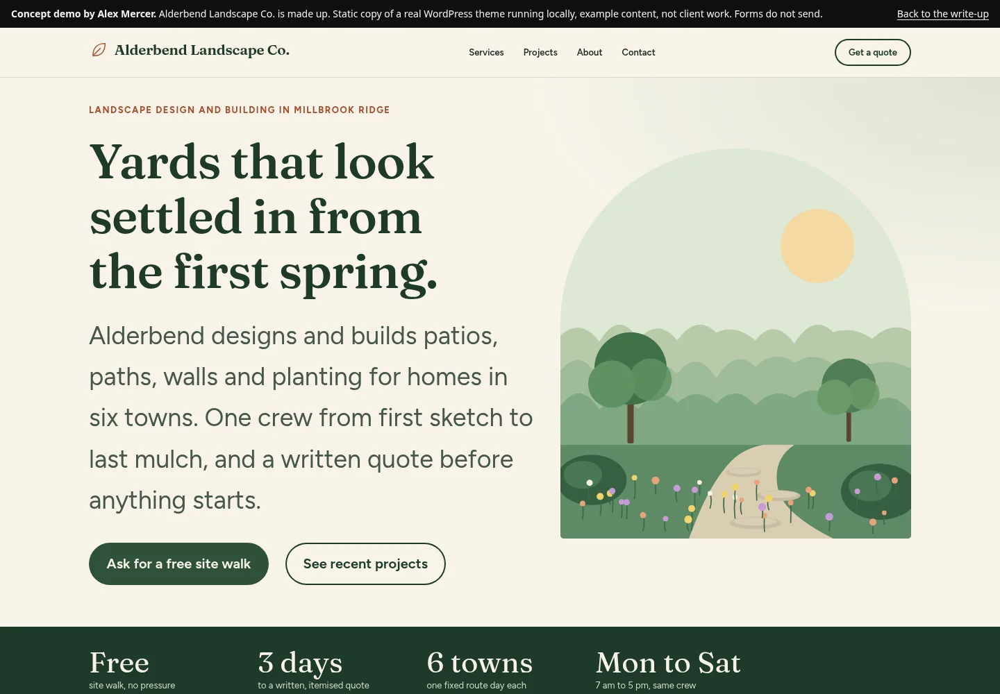

# Alderbend: a from-scratch WordPress block theme

A full-site-editing WordPress theme written from scratch for a made-up landscaping company, **Alderbend Landscape Co.** No starter theme, no framework, no page builder.

This is a concept demo. Alderbend, its towns (Millbrook Ridge, Harrow Landing and so on), projects, prices, the (555) phone number and the example.com email are all made up. It is not client work, it has not run on a real business's site, and no traffic, leads or results are claimed.

## See it

- Write-up with code excerpts, file tree and real test output: https://alexmercerprojects.com/alderbend-wordpress-theme/
- The demo site: https://alexmercerprojects.com/alderbend-wordpress-theme/site/

GitHub Pages cannot run PHP, so the demo site is a **static export of the real theme running in WordPress** on my machine (`tools/export-static.mjs`). Links, the phone menu and the town checker work. The quote form can't send anything there; it says so.



## What's in the theme

`theme/alderbend/` is the theme you install.

- `theme.json` (v3): 8-colour palette, fluid type scale, spacing scale, shadow and radius presets, and styling for core blocks. Most of the look lives here, not in CSS (`assets/css/theme.css` is about 15 KB).
- 8 templates (front page, page, wide page, projects index, archive, single project, search, 404) and 2 parts (header, footer).
- 16 block patterns written as PHP, so links use `home_url()` and every string is translatable: hero, facts strip, services grid, featured projects (Query Loop), process, seasonal calendar, service area, call to action, FAQ, service detail rows, about, contact, page heading, header and footer.
- 6 block styles (group Card and Soft panel, image Arch, list Checklist, paragraph Kicker, button Ghost) and one style variation (`styles/clay.json`).
- 2 dynamic blocks, each with `block.json` and a PHP `render.php`:
  - **Service area checker** lists towns with a route day and lets a visitor type theirs (1.8 KB of plain JavaScript, loaded only where the block is used).
  - **Quote request form** posts to `admin-post.php`, with a nonce, a honeypot, per-field validation, a one-minute rate limit, a header-injection-safe subject, and an email to the site admin address. Errors keep what the visitor typed and are announced to screen readers.
- Self-hosted Fraunces and Figtree (SIL Open Font License, texts in `assets/fonts/`), original SVG illustrations drawn by `tools/make_images.py`, a generated `.pot` file. No CDN, no tracking.

## Install

1. Download `alderbend-theme.zip` from the write-up page, or copy `theme/alderbend` into `wp-content/themes/`. Needs WordPress 6.5 or newer.
2. Activate it under Appearance, Themes.
3. The header links expect pages with the slugs `services`, `projects`, `about` and `contact`; set a Home page as the front page and Projects as the posts page. Or fill a fresh site with the made-up content:

```
WP="wp --path=/path/to/wordpress" bash demo/seed.sh
```

The quote form emails the address under Settings, General.

## Checks

```
tools/run-tests.sh      # PHP lint, PHPCS, 54 checks inside WordPress, 66 HTTP checks
node tools/editor-check.mjs <post-id>     # opens the patterns in the block editor, reports invalid blocks
node tools/check-links.mjs <origin> <path>  # crawls the static export
node tools/interaction-check.mjs <url>    # phone menu, town checker, demo form
```

Needs PHP 8, WP-CLI, PHPCS with the WordPress standards, Node 22 and Chrome. The latest raw output is in `docs/evidence/`.

## What was tested and what wasn't

Tested on WordPress 7.1.5 with PHP 8.5.8 and SQLite, using PHP's built-in server and headless Chrome (1440 and 390 px wide): PHP lint and PHPCS (WordPress-Extra, WordPress-Docs) with no errors; 120 automated checks; 15 of the 16 patterns (all but the one-button 404 pattern) and both blocks open in the block editor with no validation errors; no horizontal scroll, console errors or outside requests; the static export crawled with no broken links.

Not tested: MySQL or MariaDB, Apache or nginx, other PHP versions (the header says 7.4+ but only 8.5 was run), multisite, caching or SEO plugins, Firefox or Safari, real devices, screen readers or an accessibility audit tool, and real email delivery (`wp_mail()` was replaced by a stand-in). The WordPress.org Theme Check plugin has one required item: it flags `register_block_type()` because blocks are plugin territory in the theme directory. The two blocks stay in the theme because they belong to this one site's design; to list the theme on wordpress.org they would move into a plugin.

## Licence

Theme code: GPL v2 or later. Fonts: SIL Open Font License 1.1. Illustrations: original, released under the same GPL licence.
